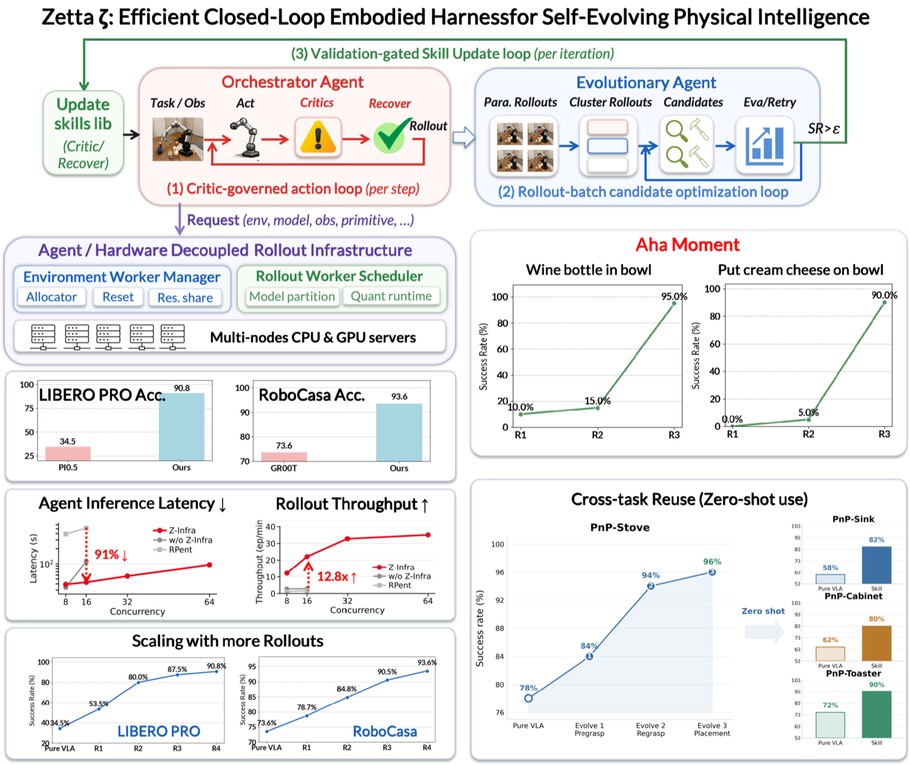

<div align="center">
  
</div>

<div align="center">
<a href="https://arxiv.org/abs/2608.16590"></a>
<a href="https://paperswithcode.co/api/v1/papers/2608.16590/leaderboard-badge-link?eval=26154"></a>
<a href="https://github.com/air-embodied-brain/Zetta-Embodiment/actions/workflows/unit-tests.yml"></a>

</div>

<div align="center">
  
</div>

Zetta is an efficient closed-loop embodied harness for self-evolving physical intelligence. It evolves code-based runtime critics and recovery skills online while keeping the base policy frozen, achieving state-of-the-art success on LIBERO-Pro (90.8%) and RoboCasa (93.6%) with an 11.1x inference speedup.

## What's New

- [2026/10/25] 🔥 Zetta adds a FlashRT policy backend for Pi0.5 (FP8 + CUDA Graph): 9.9× lower single-sample latency model-only and 4.5× through the gateway on a single RTX 4090. Docs: [FlashRT integration](#flashrt-integration), [FlashRT performance report (中文)](docs/flashrt-report/flashrt-vs-zetta-openpi.md).
- [2026/10/04] 🔥 Zetta supports the BEHAVIOR environment (OmniGibson / BEHAVIOR-1K runtime contract). Doc: [BEHAVIOR / OmniGibson](docs/behavior.md).
- [2026/10/03] 🔥 Zetta adds an opt-in nvJPEG-backed JPEG codec for camera observations: 27× faster image encoding and 2.2× higher env-side throughput on LIBERO-Pro in isolated benchmarks. Report: [nvJPEG optimization report (中文)](docs/img-encode-report/nvjpeg-optimization-report.md).
- [2026/09/16] 🔥 Zetta supports the ManiSkill environment (native Panda/PickCube; model validation pending). Doc: [ManiSkill deployment and contracts](docs/maniskill.md).
- [2026/09/10] 🔥 Zetta supports the Genie Sim environment. Docs: [Genie Sim](docs/geniesim.md), [Genie Sim VLA and Campaign](docs/geniesim-vla.md).
- [2026/09/03] 🔥 Zetta supports the RoboTwin environment. Doc: [RoboTwin 2.0 setup](#robotwin-20-environment).

<details>
<summary><b>More updates</b></summary>

- [2026/08/27] 🔥 Zetta supports NVIDIA Cosmos models. Doc: [Cosmos-Lite policy backend](docs/cosmos-lite.md).
- [2026/08/19] 🎉 Z-Infra is open-sourced with LIBERO support.
- [2026/08/18] 🎉 Zetta is open-sourced with LIBERO and RoboCasa.

</details>

🚀 **Roadmap:** we continue to expand model and environment coverage at an approximate cadence of one integration per week.

## How It Works

### Evolution Protocol

```text
50 development rollouts (never use seeds 1..20)
  -> Failure Cluster
  -> Stage 1 causal Diagnose
  -> Stage 2 Critic-Recovery Candidates
  -> Shadow Replay
  -> paired Same-seed Gate
  -> Held-out seeds 1..20
     -> validation mode: Reject (refine if budget remains), or Promote
     -> test mode: Record an unbiased final report without feeding selection
```

### Runtime Role Boundaries

- **Cluster** groups complete failed trajectories using synchronized video, bounded telemetry, and failure segments.
- **Stage 1 / Diagnose** explains one observable causal failure mechanism and cannot write or execute recovery actions.
- **Stage 2 / Candidate writer** emits one frozen Critic-Recovery bundle whose parameters must satisfy the published tool schemas.
- **Critic** reads temporal evidence and may only propose a recovery.
- **Role1** accepts or rejects a Critic proposal and is the sole high-level decision authority during candidate execution.
- **Recovery actor** executes only an accepted, bounded recovery program; only the environment actor may write simulator actions.

## Supported Environments and Models

| Environment | Policy | Runtime preset | Campaign preparation | Docs | Status |
|---|---|---|---|---|---|
| LIBERO-Pro | π₀.₅ | `a100_libero_pi05_pro.yaml` | `prepare_libero_campaign.py` | [VLA runtime setup](scripts/deployment/VLA_ENV_SETUP.md), [Recovery tools](docs/libero-recovery-tools.md) | ✅ |
| RoboCasa | GR00T, π₀ | `robocasa_groot_dynamic.yaml`, `robocasa_pi0.yaml` | `prepare_robocasa_campaign.py` | [VLA runtime setup](scripts/deployment/VLA_ENV_SETUP.md) | ✅ |
| RoboTwin 2.0 | π₀.₅ | `robotwin_pi05.yaml` | `prepare_robotwin_campaign.py` | [Installation](#robotwin-20-environment) | ✅ |
| Genie Sim | G2 VLA service | `geniesim_vla.yaml` | `prepare_geniesim_campaign.py` | [Genie Sim VLA and Campaign](docs/geniesim-vla.md) | ✅ single task |
| ManiSkill | — (fake-policy smoke) | `maniskill_smoke.yaml` | `prepare_maniskill_campaign.py` | [ManiSkill](docs/maniskill.md) | 🚧 model validation pending |
| BEHAVIOR | π₀.₅ | `behavior_pi05.yaml` | — | [BEHAVIOR / OmniGibson](docs/behavior.md) | 🚧 runtime only |

Runtime presets live under `rollout_runtime/config/presets/` and campaign preparation scripts under `scripts/evolution/`. [Cosmos-Lite](docs/cosmos-lite.md) is available as an additional remote policy backend (`cosmos_lite_remote.yaml`).

## Installation

### Minimal test environment

Python 3.11 through 3.12 is supported. The minimal test environment (no simulator/model required):

```bash
python -m venv .venv
source .venv/bin/activate
python -m pip install --upgrade pip
python -m pip install -e ".[test]"
```

### LLM provider

Campaigns call LLM agents in two places, configured separately:

- **Offline campaign stages** (Cluster, Diagnose, Stage 2) always use the Codex
  planner (`openai-codex`). Set `CODEX_API_KEY`, plus `CODEX_BASE_URL` for an
  OpenAI-compatible gateway; `run_campaign.py --model` selects the model. To fail
  over across several routes, set `ZETTA_API_PROVIDERS` to a JSON list of routes
  (`name`, `model`, `base_url`, and `api_key` or `api_key_env`).
- **Online Role1** reviews Critic proposals during candidate rollouts. The LIBERO,
  RoboCasa and RoboTwin preparation scripts freeze its backend via
  `--role1-planner api|codex` and `--role1-model`. The `api` planner takes a
  provider-prefixed model id (e.g. `openai:<model>`) and reads the provider's own
  key (`OPENAI_API_KEY`, `ANTHROPIC_API_KEY`, …); on LIBERO and RoboCasa,
  `ZETTA_ROLE1_BASE_URL` overrides its base URL. The `codex` planner uses the
  `CODEX_*` variables above.

Store these secrets as described in [Security and Reproducibility](#security-and-reproducibility).

### VLA runtime environment (LIBERO-Pro or RoboCasa)

`scripts/deployment/install_vla_env.sh` builds a venv for one of two tracks. See
the [VLA runtime setup guide](scripts/deployment/VLA_ENV_SETUP.md) for the full
installation notes, compatibility fixes, and known limitations.

> [!WARNING]
> The two tracks cannot share a venv state (incompatible `robosuite` versions).

**Prebuilt Docker images**, built from `scripts/deployment/Dockerfile.vla-env`, are available for both tracks so you can skip the manual venv build:

- **LIBERO-Pro** image: preconfigured with the LIBERO-Pro simulator stack and Pi0.5 dependencies. [Baidu Netdisk (百度网盘)](https://pan.baidu.com/s/1HW7AstjCLE_BTScRFOQT2g?pwd=qv7c)
- **RoboCasa** image: preconfigured with the RoboCasa/robosuite/Isaac-GR00T stack. [Baidu Netdisk (百度网盘)](https://pan.baidu.com/s/1Zyg2i_3tMp249PPLK6_JAw?pwd=ztcp)

**LIBERO-Pro + Pi0.5**

```bash
export REPO_ROOT=/abs/path/to/Zetta-Embodiment
export VENV_ROOT=/abs/path/to/venvs/vla-env
bash scripts/deployment/install_vla_env.sh --track libero-pro
```

`install_vla_env.sh` downloads the LIBERO-Pro scene/object assets automatically. To fetch or refresh them manually:

```bash
"$VENV_ROOT/bin/liberopro-download-assets" --skip-existing
```

**RoboCasa + GR00T** (needs a source checkout with `robocasa/`, `robosuite/`, `Isaac-GR00T/`)

```bash
export REPO_ROOT=/abs/path/to/Zetta-Embodiment
export VENV_ROOT=/abs/path/to/venvs/vla-env
export ROBOCASA_SRC_ROOT=/abs/path/to/robocasa-source-checkout
bash scripts/deployment/install_vla_env.sh --track robocasa
```

RoboCasa also needs its kitchen assets (~10GB); see the [RoboCasa installation guide](https://robocasa.ai/docs/build/html/introduction/installation.html) for details:

```bash
python -m robocasa.scripts.setup_macros              # set up system variables
python -m robocasa.scripts.download_kitchen_assets   # downloads ~10GB of kitchen assets
```

### RoboTwin 2.0 environment

**RoboTwin 2.0 + Pi0.5**

RoboTwin is SAPIEN-based and cannot share a venv with either track above. Use the
upstream RLinf image rather than building one:

```bash
git clone https://github.com/RoboTwin-Platform/RoboTwin.git -b RLinf_support
# then download ~15GB of assets into its assets/ directory

docker run --rm --gpus all --shm-size 32g \
  -e NVIDIA_DISABLE_REQUIRE=1 \
  -e NVIDIA_DRIVER_CAPABILITIES=compute,utility,graphics \
  -e LD_LIBRARY_PATH=/usr/lib/x86_64-linux-gnu:/usr/local/cuda/lib64 \
  --device /dev/dri \
  -v "$ROBOTWIN_ROOT":/workspace/RoboTwin \
  -v "$REPO_ROOT":/workspace/Zetta \
  --entrypoint /bin/bash rlinf/rlinf:agentic-rlinf0.4-robotwin
```

The image ships three venvs under `/opt/venv/`; this repository uses `openpi`.
`assets_path` must point at the RoboTwin repository root, not its `assets/`
subdirectory.

<details>
<summary><b>Why these environment variables?</b></summary>

The three environment variables let a CUDA 12.8 image run on a 12.4 driver:
`NVIDIA_DISABLE_REQUIRE` skips the image's `cuda>=12.8` label check,
`NVIDIA_DRIVER_CAPABILITIES` drops the `display` capability that needs a
`/dev/nvidia-modeset` a headless host does not have, and `LD_LIBRARY_PATH` puts
the host driver's `libcuda` ahead of the image's forward-compatibility libraries
— CUDA forward compatibility is datacenter-only and fails on GeForce with
`Error 804`.

</details>

### Genie Sim / Isaac Sim environment

The native `geniesim` Runtime backend supports the RoboColiseum
`g2op_if_pick_block_color` task with Isaac Sim 5.1 and an isolated Python 3.11
simulator process. Use [prepare_geniesim.py](scripts/deployment/prepare_geniesim.py)
to prepare pinned dependencies and task assets, then run
[smoke_geniesim.py](scripts/deployment/smoke_geniesim.py) to validate reset,
joint control, RGB observations, official scoring, and shutdown.
The `geniesim_vla` backend adds the G2 CoRobot WebSocket policy protocol, and
`prepare_geniesim_campaign.py` freezes VLA rollout and candidate gate commands.
See [Genie Sim VLA and Campaign](docs/geniesim-vla.md) for the model-service
contract, deployment, evidence, and current single-task limits.

### ManiSkill environment

The native Panda / `PickCube-v1` integration adds explicit observation/action
contracts, official scoring, reproducible resets and a single-GPU Ray smoke preset.
See [ManiSkill deployment and contracts](docs/maniskill.md) for installation,
validation and frozen rollout/campaign configuration. Real VLA and campaign
validation requires a matching native PickCube checkpoint and normalization stats.

### BEHAVIOR environment

The `behavior` Runtime backend drives a single R1Pro agent in an OmniGibson
`BehaviorTask`. It exposes the BEHAVIOR policy contract (224px RGB, two wrist
views, full R1Pro proprioception, and 23-dimensional actions) and keeps
OmniGibson/BDDL optional so the simulator-free test environment remains usable.
See [BEHAVIOR / OmniGibson](docs/behavior.md) for details.

<details>
<summary><b>Installation steps</b></summary>

Install the repository's lightweight extra first:

```bash
python -m pip install -e ".[behavior]"
```

Then install the matching OmniGibson and BDDL checkouts from their upstream
repositories and download the BEHAVIOR assets separately. Set
`env_config.activity_name`, `scene_model`, and `env_config.env_factory` in
`rollout_runtime/config/presets/behavior_pi05.yaml` for the selected checkout.
Use `scripts/deployment/smoke_behavior.py` to verify import, reset, one step,
and close before starting a VLA rollout. Model weights and simulator assets are
external artifacts and are not included in this repository.

</details>

## Runtime Rollout System

Campaigns drive rollouts through the Rollout Runtime rather than talking to a per-task VLA/env server directly. Start it once per host, then point campaign preparation at it:

```bash
CUDA_VISIBLE_DEVICES=0 MUJOCO_GL=egl \
python -m rollout_runtime.cli serve \
  --config <preset-name-or-yaml-path> \
  --host 127.0.0.1 \
  --port 18730 \
  --launch ray
```

> [!WARNING]
> `--launch ray` is required for real hardware runs: it puts the EnvWorker (simulator) and RolloutWorker (model inference) groups into separate processes. `--launch local` (the default) keeps them in one process and is only for local/CI smoke tests.

Presets live under `rollout_runtime/config/presets/`; copy and edit one for machine-specific GPU/checkpoint paths rather than committing a new preset with real paths.

## Preparing and Running a Campaign

LIBERO, RoboCasa, RoboTwin, Genie Sim and ManiSkill all use the same two-step flow: `prepare_*_campaign.py` freezes a `manifest.json`/`tool-catalog.json` against a running runtime, then `run_campaign.py` drives the campaign state machine to completion.

```bash
# 1. Start the runtime (see above), then prepare the campaign against it.
python scripts/evolution/prepare_libero_campaign.py \
  --output-root runs/libero-goal-s-task3/g0000 \
  --campaign-id libero-goal-s-task3-g0000 \
  --repository-root "$PWD" \
  --runtime-python .venv/bin/python \
  --code-commit "$(git rev-parse HEAD)" \
  --suite libero_goal_swap \
  --task-id 3 \
  --task libero_goal_swap/task3 \
  --task-language "Open the top layer of the drawer and put the bowl inside" \
  --master-seed 2026081103 \
  --rollout-count 50 \
  --fixed-heldout-seeds 1-20 \
  --heldout-mode test \
  --runtime-url http://127.0.0.1:18730 \
  --runtime-policy-id <policy-id>

# `--heldout-mode test` keeps the fixed block report-only. To make a held-out
# failure reject the candidate, preregister `--heldout-mode validation` instead.

# 2. Run it: this starts the worker, ingests episodes, and drives
#    Cluster -> Diagnose -> Stage2 -> Shadow Replay -> Same-seed -> Held-out.
python scripts/evolution/run_campaign.py \
  --manifest runs/libero-goal-s-task3/g0000/manifest.json \
  --root runs/libero-goal-s-task3/g0000 \
  --queue-root runs/libero-goal-s-task3/queue \
  --tool-catalog runs/libero-goal-s-task3/g0000/tool-catalog.json \
  --workers libero-worker-0 \
  --model <model-name> \
  --max-generations 1
```

> [!NOTE]
> Replace `<model-name>` with a model served by your Codex provider (see [LLM provider](#llm-provider)).
> As of 2026/09/20, our experiments use `gpt-5.6-sol`; we will keep this updated as newer models are evaluated.

`--worker-command` (optional, must be the final flag) overrides how each worker process is launched, substituting `{queue_root}`/`{host}` into a custom command template; omit it to use the default `zetta.evolution.cli worker` invocation.

`--runtime-url`/`--runtime-policy-id` replace the legacy `--vla-endpoint`/`--environment-gpus` flags; RoboCasa campaigns always go through the runtime (there is no direct-connect path). `ROLLOUT_COUNT=50`, `HELDOUT_COUNT=20`, and the official horizons are the formal-run defaults. Each preparation script's `--help` output is the authoritative option list.

> [!NOTE]
> A quick infrastructure check may use 1/1/1 with a positive `CAMPAIGN_MAX_STEPS`, but that is not a benchmark result.

> [!NOTE]
> **RoboTwin** differs in two ways that its manifest records explicitly. Its seeds come
> from RoboTwin's curated per-task success-seed list rather than a dense integer
> range — the environment picks its scene from the seed outright, so a held-out
> block drawn from unsolvable scenes would not be a gate — and its evidence is
> chunk-granular rather than per-step, because it is the only `final_only` family.
>
> The RoboTwin campaign loop runs end to end on hardware: rollouts, Cluster,
> Diagnose, Stage 2, and the paired same-seed gate, over five candidate rounds to a
> `complete` campaign.

### Inspecting a campaign

To inspect a campaign read-only:

```bash
python -m zetta.evolution.cli status --root runs/libero-goal-s-task3/g0000 \
  --queue-root runs/libero-goal-s-task3/queue
```

### Campaign root layout

A campaign root normally contains:

```text
manifest.json             frozen task, schedule, runtime, and gate contract
preregistration.json      seed and evaluation commitments
task-contract.json        authoritative language goal, when supplied
tool-catalog.json         exact tool schemas available to candidates
state.json                current lifecycle phase
episodes/                 canonical rollout and paired-gate records
failure-clusters/         Cluster inputs, visual indices, and outputs
diagnoses/                Stage 1 inputs, outputs, and audit trail
proposals/                Stage 2 candidate attempts
shadow-replay/            offline trigger and false-positive evidence
gates/                    same-seed, regression, and held-out decisions
promoted/                 verified candidate bundle and hashes
```

## Repository Layout

| Path | Purpose |
|---|---|
| `zetta/evolution/` | Immutable manifests, queues, clustering, stages, gates, promotion, and supervision |
| `rollout_runtime/` | The Rollout Runtime: Gateway, EnvWorker/RolloutWorker groups, and backends for LIBERO/RoboCasa/ManiSkill/BEHAVIOR/RoboTwin/Genie Sim |
| `robots/libero/`, `robots/robocasa/`, `robots/robotwin/` | Env clients, Role1/Critic/Recovery, tools, and rendering contracts |
| `robots/geniesim/`, `robots/maniskill/`, `robots/behavior/` | Environment contracts and rollout entrypoints |
| `scripts/evolution/` | Campaign preparation, workers, capacity probes, and plots |
| `scripts/deployment/` | Service start/stop, VLA env install, and Docker build helpers |
| `tests/` | Unit/contract tests; the minimal set requires no simulator or model |

Videos, model weights, simulator assets, API credentials, and host runtime files remain outside Git.

## Tests

```bash
# Contract suite, no simulator/model required:
python -m pytest -q tests/test_evolution_protocol.py tests/test_evolution_core.py tests/test_libero_eval_horizon.py

# Everything currently available:
python -m pytest -q
```

Optional-backend tests require the corresponding dependencies; hardware/service smoke tests live under `scripts/deployment/` and are not part of the minimal unit suite.

## Security and Reproducibility

- Store secrets only in environment variables or permission-restricted external files. Artifacts record only route names and irreversible fingerprints, not keys or service URLs.
- Keep development seeds disjoint from held-out seeds 1..20.
- Preserve manifests, tool catalogs, prompts, bundles, and episode records by content hash; do not edit a running campaign in place.
- Classify infrastructure failures separately from valid task failures; they do not count as zero scores and cannot become learning signals.
- Use privileged simulator state only through an explicitly authorized and auditable diagnostic feature contract; it must not become hidden task control.
- Treat held-out results as test-only unless `heldout_mode=validation` is preregistered before any episode runs.

## FlashRT Integration

The `flashrt` policy backend (`rollout_runtime/backends/flashrt_policy.py`) serves Pi0.5 with FlashRT's FP8 + CUDA Graph kernels, including a batched `infer_batch` path. On a single RTX 4090 it cuts Pi0.5 single-sample latency 9.9× model-only (230.4 → 23.3 ms) and 4.5× through the gateway (271.3 → 60.5 ms), with 0.9989 action cosine similarity to the `zetta_openpi` baseline; see the [FlashRT performance report](docs/flashrt-report/flashrt-vs-zetta-openpi.md).

1. **Install FlashRT** (no PyPI wheel; build locally with a CUDA toolchain, see [FlashRT](https://github.com/flashrt-project/FlashRT#build--install)), then `pip install -e ".[flashrt]"` for the torch glue.
2. **Prepare the checkpoint:** `bash scripts/deployment/prepare_flashrt_ckpt.sh <openpi_ckpt_dir> <dst_dir>` lays out an openpi/RLinf Pi0.5 checkpoint the way FlashRT expects.
3. **Generate the calibration `.npz`** (a real LIBERO frame for FP8 calibration): start the gateway with a LIBERO preset, then run `python scripts/experiments/capture_flashrt_calibration_frame.py --url http://localhost:8711 --token <token> --out /path/to/out/flashrt_calibration.npz`.
4. **Run:** set `checkpoint` and `calibration_data_path` in `rollout_runtime/config/presets/libero_pi05_flashrt_4090.yaml` and launch the gateway with it (`policy_backend: flashrt`).

**GR00T N1.5 (RoboCasa).** The `flashrt_groot` policy backend (`rollout_runtime/backends/flashrt_groot_policy.py`, preset `robocasa_groot_flashrt`) serves GR00T N1.5 through a torch CUDA-Graph accelerator (`rollout_runtime/backends/flashrt_groot_n15.py`: one static-shape graph per prompt shape, flash-attn kept inside the graph, DiT cross-attention K/V cache). FlashRT has no N1.5 frontend, so this path does not use FlashRT kernels and needs none of the steps above. On an RTX 4090 (`huangmz21/gr00t-n1.5-robocasa-atomic-seen-180k`, three 256×256 views, ~820 prompt tokens) `get_action` drops from 94.7 ms (eager) to 44.2 ms, 31.0 ms of which is graph replay, with 0.999995 action cosine similarity to the eager path and identical gripper/control decisions. Batches larger than one fall back to the eager path, which matches the `groot` backend exactly. It needs `flash_attn` importable and a `Gr00tPolicy` whose `get_action` calls `_get_action_from_normalized_input` (the `robocasa-benchmark/Isaac-GR00T` fork, which also provides `panda_omron`); forks that route elsewhere are rejected at load. On a busy host, cap CPU threads (e.g. `OMP_NUM_THREADS=8`): with one torch thread per core, Eagle preprocessing alone can take hundreds of milliseconds.

## Acknowledgements

We acknowledge [RLinf](https://github.com/RLinf/RLinf) and [FlashRT](https://github.com/flashrt-project/FlashRT) for their prior work. See [Third-Party Notices](./THIRD_PARTY_NOTICES.md) for details.

## Citation

If you find Zetta useful in your research, please cite our paper:

```bibtex
@misc{ding2026zettazetaefficientclosedloop,
      title={Zetta $\zeta$: An Efficient Closed-Loop Embodied Harness for Self-Evolving Physical Intelligence}, 
      author={Xin Ding and Liang Mi and Mingzhe Huang and Zixuan Wang and Chao Zhang and Zixu Hao and Fu Chen and Xiangyu Li and Yikai Zheng and Yaoyu Guo and Weijun Wang and Kun Li and Hao Wu and Yunxin Liu and Ting Cao},
      year={2026},
      eprint={2608.16590},
      archivePrefix={arXiv},
      primaryClass={cs.RO},
      url={https://arxiv.org/abs/2608.16590}, 
}
```

## License

Zetta is released under the [Apache-2.0 License](LICENSE). Portions adapted from third-party projects retain their original attribution; see [Third-Party Notices](./THIRD_PARTY_NOTICES.md).
