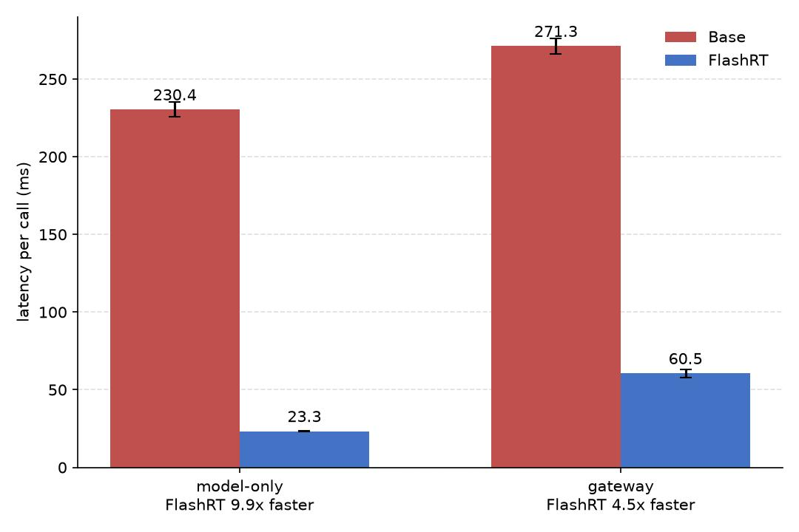
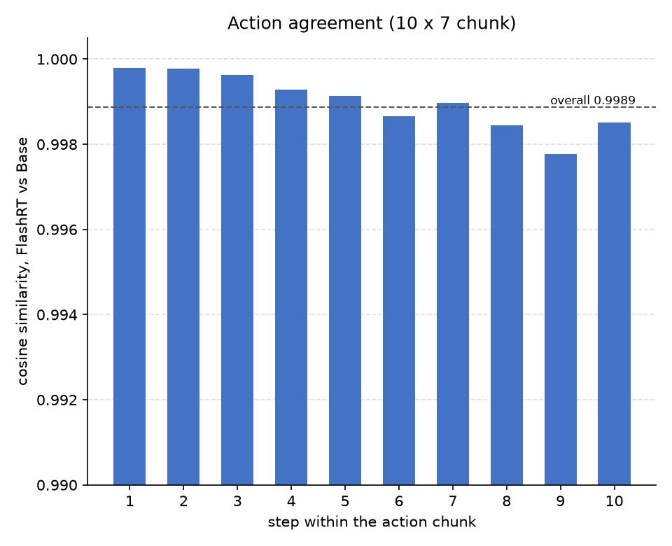
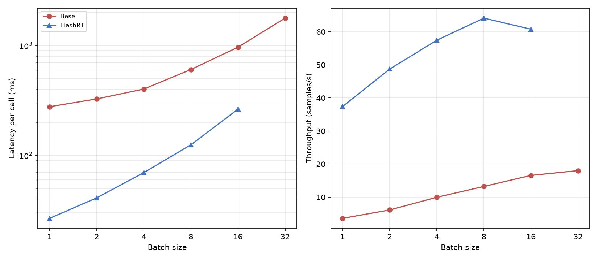
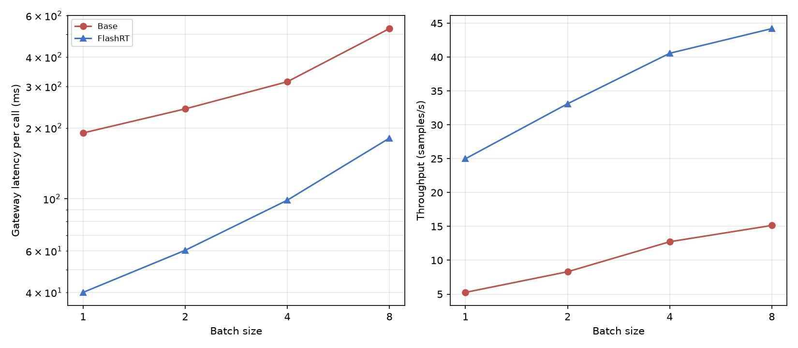
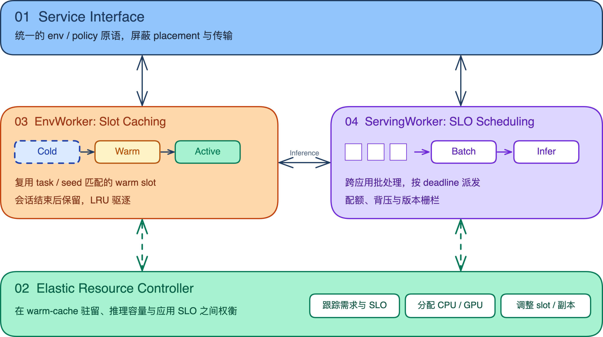

# FlashRT × Z-Infra：Pi0.5 VLA 推理加速报告

对比对象：**Base** = Zetta 默认的 `zetta_openpi` 策略后端（PyTorch eager）；
**Change** = 新增的 `flashrt` 策略后端（`rollout_runtime/backends/flashrt_policy.py`，
FP8 量化 + CUDA Graph）。两侧使用同一份 Pi0.5 权重和同一帧真实 LIBERO 观测。

## 一、结论摘要

| 测试项 | Base | FlashRT | 提升 |
|---|---|---|---|
| 单样本延迟（model-only） | 230.4 ms | 23.3 ms | **9.9×** |
| 单样本延迟（gateway 全链路） | 271.3 ms | 60.5 ms | **4.5×** |
| 批量吞吐（model-only，batch=8） | 13.2 样本/s | 64.1 样本/s | **4.8×** |
| 批量吞吐（gateway，batch=8） | 15.1 样本/s（528 ms/次） | 44.2 样本/s（181 ms/次） | **2.9×** |
| 动作精度（与 Base 输出对比） | — | 余弦相似度 0.9989，逐元素最大偏差 0.081 | 无结构性偏移 |

> **限制**：网关内 LIBERO 渲染与模型共用一张 24GB 显卡，单卡网关最大支持
> batch=8。

---

## 二、问题与解决

| 问题 | 原因 | 解决 |
|---|---|---|
| Base 单次推理 230–280 ms，慢于控制周期 | PyTorch eager 逐 kernel 启动，batch=1 时被 launch 开销主导 | 新增 `flashrt` 策略后端：FP8 量化 + 整段 CUDA Graph |
| FlashRT 无法直接接入网关 | 环境渲染 256²，而 FlashRT 前端固定 224²；FP8 需要真实数据校准；FlashRT API 仅支持单样本 | 224² resize-with-pad；用真实 LIBERO 帧做 FP8 校准；批量 CUDA Graph（失败时回退到逐请求推理） |
| 首轮动作与 Base 不一致 | 反归一化在分位数映射前多做了一次 `clip(-1, 1)` | 去掉该 clip，已合入上游 [FlashRT#209](https://github.com/flashrt-project/FlashRT/pull/209) |
| 缺少严格同条件对比 | 没有统一的基准与观测 | model-only / gateway / batch sweep 三套基准，使用同一份真实观测 |

---

## 三、测试环境

| 项 | 内容 |
|---|---|
| 模型 | Pi0.5（`RLinf-Pi05-LIBERO-130-fullshot-SFT`），7-DoF，chunk=10，两侧同一份权重 |
| 输入 | 同一帧真实 LIBERO 观测（`libero_10` task 0）；网关测试 seed=1 |
| 硬件 | 1× RTX 4090 24GB（独占）；Xeon Gold 6530（128 线程），Ubuntu 22.04 |
| 采样 | 单样本：10 次剔除首次，取 9 次均值 ± 标准差；batch sweep：1 次首调用 + 3 次预热 + 20 次计时 |
| 层级 | **model-only**：进程内直接调用推理核心；**gateway**：完整网关（HTTP + msgpack + Ray） |

---

## 四、单样本延迟

| 层级 | Base | FlashRT | 加速比 |
|---|---|---|---|
| model-only | 230.4 ± 4.8 ms | 23.3 ± 0.2 ms | **9.9×** |
| gateway | 271.3 ± 5.2 ms | 60.5 ± 2.5 ms | **4.5×** |

- 网关比 model-only 多约 37–41 ms（编解码、Ray 调度、会话管理），两侧基本相同。
- 模型变快后，这部分固定开销的占比升高，因此加速比从 9.9× 降到 4.5×。

---

## 五、动作精度

同一 checkpoint、同一帧观测、同一 seed，经网关取 10×7 action chunk，逐步计算余弦
相似度；整体值为展平后计算。

| 指标 | 结果 |
|---|---|
| 整体余弦相似度 | **0.9989** |
| 单步余弦范围 | 0.9978 – 0.9998 |
| 最大 / 平均绝对差 | 0.081 / 0.013 |

误差量级与 FP8 量化的预期一致，**无结构性偏移**。

---

## 六、批量吞吐（model-only）

| batch | 1 | 2 | 4 | 8 | 16 | 32 |
|---|---|---|---|---|---|---|
| Base 延迟 / 吞吐 | 277.3 / 3.6 | 326.2 / 6.1 | 401.3 / 10.0 | 604.5 / 13.2 | 965.2 / 16.6 | 1775.9 / 18.0 |
| FlashRT 延迟 / 吞吐 | 26.7 / 37.4 | 41.0 / 48.7 | 69.6 / 57.5 | 124.7 / **64.1** | 263.3 / 60.8 | 显存不足 |
| 吞吐比 | 10.4× | 7.9× | 5.8× | **4.8×** | 3.7× | — |

延迟单位 ms，吞吐单位 样本/s；B 个请求为同一帧观测的拷贝。

分析：

- **Base** 靠 batch 摊薄 launch 开销（单样本 277 → 55 ms），但 batch=32 时单次延迟
  达 1.8 s，吞吐仅 18 样本/s。
- **FlashRT** 吞吐随 batch 增长，batch=8 达峰 **64.1 样本/s**；batch=16 因计算饱和
  略降；batch=32 在 24GB 上显存不足。
- 所有 batch 下 FlashRT 吞吐均为 Base 的 **3.7× 以上**（batch=1：26.7 ms；batch=8：
  124.7 ms，Base 为 604.5 ms）。

> **方法**：Base 为 PyTorch 一次 batched 前向；FlashRT 为 FP8 + 一张批量 CUDA
> Graph；每个 B 在全新进程中测量。

---

## 七、批量吞吐（gateway）

| batch | 1 | 2 | 4 | 8 | 16 / 32 |
|---|---|---|---|---|---|
| Base 延迟 / 吞吐 | 190.4 / 5.3 | 240.9 / 8.3 | 314.1 / 12.7 | 528.3 / 15.1 | 显存不足 / 无法完成 |
| FlashRT 延迟 / 吞吐 | 40.0 / 25.0 | 60.4 / 33.1 | 98.6 / 40.6 | 181.0 / **44.2** | 显存不足 / 无法完成 |
| 吞吐比 | 4.8× | 4.0× | 3.2× | **2.9×** | — |

延迟单位 ms，吞吐单位 样本/s。这里测的是 `policy_infer`（仅推理，不步进环境），因此
B=1 的延迟低于第四节中经 `policy_step` 测得的单样本网关延迟。

分析：

- FlashRT 全程更低：B=8 时 181.0 ms，仅为 Base（528.3 ms）的 **34%**。
- 加速比低于 model-only（B=8：2.9× vs 4.8×），因为网关固定开销约 15–55 ms（随 B
  增加），两侧相同。
- **B ≥ 16 无法在单卡 24GB 上运行**：每个会话有一个 LIBERO 环境，渲染与模型共用
  同一张卡。B=16 时两侧均显存不足；B=32 时环境创建后显存即占满。
- 设置：`scheduler.max_batch_size = B`，`scheduler.max_wait_ms = 50`；FlashRT 另设
  `scheduler.fixed_batch_size = B`，日志确认未回退到逐请求推理。

---

## 八、交付内容

1. **Zetta 框架**：FlashRT 后端 `rollout_runtime/backends/flashrt_policy.py`
   （含批量 `infer_batch` 路径）、单卡 4090 预设
   `rollout_runtime/config/presets/libero_pi05_flashrt_4090.yaml`、checkpoint 布局脚本
   `scripts/deployment/prepare_flashrt_ckpt.sh`、FP8 校准帧采集脚本
   `scripts/experiments/capture_flashrt_calibration_frame.py`，以及批量调度单测
   `tests/runtime/test_flashrt_batched_infer.py`。
2. **上游 FlashRT 修复**：反归一化 clip 修复（[FlashRT#209](https://github.com/flashrt-project/FlashRT/pull/209)）
   已合入官方仓库。

安装与运行步骤见 README 的 [FlashRT Integration](../../README.md#flashrt-integration)
一节。

---

## 九、后续工作

FlashRT 把模型侧延迟压到 20 ms 量级后，网关固定开销和"环境与模型共卡"的显存约束
成为新的瓶颈。后续计划围绕四个组件展开：

| 组件 | 职责 |
|---|---|
| 01 Service Interface | 统一的 env / policy 原语，屏蔽 placement 与传输 |
| 02 Elastic Resource Controller | 跟踪需求与 SLO、分配 CPU / GPU、调整 slot / 副本，在 warm-cache 驻留、推理容量与应用 SLO 之间权衡 |
| 03 EnvWorker: Slot Caching | 环境 slot 按 Cold → Warm → Active 流转；复用 task / seed 匹配的 warm slot，会话结束后保留，按 LRU 驱逐 |
| 04 ServingWorker: SLO Scheduling | 跨应用批处理，按 deadline 派发；支持配额、背压与版本栅栏 |
